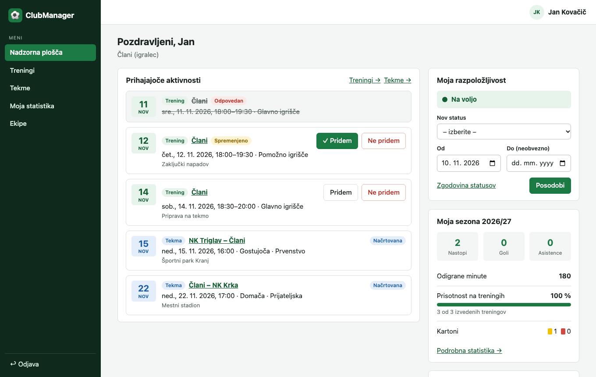

# ClubManager

Spletna aplikacija za upravljanje amaterskega nogometnega kluba z več ekipami različnih starostnih kategorij. Združuje upravljanje ekip in članstev, načrtovanje treningov in tekem, evidentiranje prisotnosti, poročila o tekmah, spremljanje razpoložljivosti igralcev ter samodejni izračun statistike igralcev in ekip.

Uporabniške vloge: administrator kluba, trener, igralec in vodja ekipe.



## Tehnologije

| Področje | Tehnologija |
|---|---|
| Frontend | React, TypeScript, Vite |
| Backend | Node.js, Express, TypeScript |
| API | REST, JSON |
| Podatkovna baza | PostgreSQL |
| ORM | Prisma |
| Avtentikacija | express-session, Argon2id |
| Lokalni razvoj | Docker Compose, npm |
| Testi | Vitest, Supertest |

## Lokalni zagon

### Predpogoji

- [Node.js](https://nodejs.org/) 22 ali novejši (z npm)
- [Docker](https://www.docker.com/) z Docker Compose (Docker Desktop mora biti zagnan)
- Git

### 1. Prenos kode

```bash
git clone https://github.com/DAVIDekNOVAK/ClubManager.git
cd ClubManager
```

### 2. Podatkovna baza in poštni strežnik

```bash
docker compose up -d
```

Ukaz zažene dva vsebnika:

| Storitev | Namen | Naslov |
|---|---|---|
| `db` | PostgreSQL 16 | `localhost:5433` |
| `mail` | Mailpit – prestreže e-pošto (povabila), nič se ne pošlje na prave naslove | SMTP `localhost:1025`, spletni vmesnik <http://localhost:8025> |

> Baza na gostitelju posluša na vratih **5433** (ne 5432), da ni navzkrižja z morebitnim lokalno nameščenim PostgreSQL. Vrata lahko spremenite s spremenljivko `POSTGRES_PORT`; v tem primeru popravite tudi `DATABASE_URL` v `backend/.env`.

### 3. Backend (REST API)

```bash
cd backend
cp .env.example .env     # privzete vrednosti ustrezajo docker-compose.yml
npm install              # namesti odvisnosti in ustvari odjemalca Prisma
npm run db:deploy        # ustvari tabele (migracije)
npm run db:seed          # napolni bazo s testnimi podatki
npm run dev              # zažene API na http://localhost:3000/api
```

Delovanje preverite na <http://localhost:3000/api/health>.

### 4. Frontend

V **drugem** terminalu:

```bash
cd frontend
npm install
npm run dev              # zažene vmesnik na http://localhost:5173
```

Aplikacijo odprite na <http://localhost:5173>. Razvojni strežnik zahteve na `/api` posreduje backendu, zato dodatne nastavitve niso potrebne.

### Testni uporabniški računi

Ukaz `npm run db:seed` ustvari demo klub z dvema ekipama, tremi sezonami, treningi, tekmami in statistiko:

| Vloga | E-pošta | Geslo | Kaj lahko preizkusite |
|---|---|---|---|
| Administrator | `admin@clubmanager.si` | `Admin1234` | sezone, ekipe, članstva, arhiviranje, povabila |
| Trener (Člani) | `trener@clubmanager.si` | `Trener1234` | treningi, prisotnost, poročila o tekmah, statistika ekipe |
| Vodja ekipe (Člani) | `vodja@clubmanager.si` | `Vodja1234` | razpored tekem, nasprotni klubi |
| Igralci (Člani) | `igralec1@clubmanager.si` … `igralec16@clubmanager.si` | `Igralec1234` | potrjevanje udeležbe, razpoložljivost, osebna statistika |

`igralec1@clubmanager.si` je hkrati igralec članov ter trener in vodja ekipe U17 (uporabnik z več vlogami).

Testne podatke lahko kadarkoli ponastavite z `npm run db:seed` (skripta najprej izprazni bazo).

### Povabilo novega člana

1. Prijavite se kot administrator in na strani **Povabila** pošljite povabilo na poljuben naslov.
2. Odprite Mailpit na <http://localhost:8025> in v prejetem sporočilu kliknite povezavo za registracijo.

## Testi

Testi API-ja preverjajo pogoje sprejemljivosti uporabniških zgodb. Tečejo na ločeni bazi `clubmanager_test`, ki se samodejno ustvari v istem vsebniku (potreben je `docker compose up -d`).

```bash
cd backend
npm test
```

Preverjanje tipov in produkcijska gradnja:

```bash
cd backend && npm run typecheck && npm run build
cd frontend && npm run build
```

## Uporabni ukazi

| Ukaz (v mapi `backend/`) | Namen |
|---|---|
| `npm run dev` | razvojni strežnik s samodejnim ponovnim zagonom |
| `npm run db:migrate` | nova migracija po spremembi `prisma/schema.prisma` |
| `npm run db:deploy` | izvedba obstoječih migracij |
| `npm run db:seed` | ponastavitev testnih podatkov |
| `npm run db:reset` | izbris baze, ponovna izvedba migracij in testni podatki |
| `npm run db:studio` | pregledovalnik baze Prisma Studio |

Ustavitev okolja: `docker compose down` (podatki ostanejo) ali `docker compose down -v` (izbriše tudi podatke baze).

## Struktura repozitorija

```
ClubManager/
├── docker-compose.yml        PostgreSQL in Mailpit za lokalni razvoj
├── backend/                  REST API (Express + TypeScript)
│   ├── prisma/               shema podatkovnega modela, migracije, testni podatki
│   ├── src/
│   │   ├── common/           napake, validacija, pravice (RBAC + članstvo), datumi, e-pošta
│   │   └── modules/          moduli: auth, uporabniki, sezone, ekipe, clanstva, povabila,
│   │                         treningi, klubi, tekme, razpolozljivost, statistika
│   └── test/                 testi API-ja po uporabniških zgodbah
├── frontend/                 uporabniški vmesnik (React + Vite)
│   └── src/
│       ├── components/       skupni gradniki in gradniki po področjih
│       └── pages/            zasloni aplikacije
└── docs/                     projektna dokumentacija
```

## Implementirane funkcionalnosti (MVP)

| Funkcionalnost | Uporabniške zgodbe |
|---|---|
| F1 – Upravljanje ekip in članstev | US-01, US-02, US-03, US-04 |
| F2 – Načrtovanje treningov | US-05, US-06 |
| F3 – Evidentiranje prisotnosti | US-07, US-08 |
| F4 – Razpored tekem | US-09, US-10 |
| F5 – Poročila o tekmah | US-11, US-12, US-13 |
| F6 – Statistika igralcev in ekip | US-14, US-15 |
| F7 – Razpoložljivost igralcev | US-16, US-17 |
| Povabila in prijava | US-18, US-19, US-20 |

Preverjanje implementacije glede na pogoje sprejemljivosti je opisano v dokumentu [07 – Preverjanje MVP](docs/07-preverjanje-mvp.md). Razvoj je voden na [GitHub Project tabli](https://github.com/users/DAVIDekNOVAK/projects/3).

## Dokumentacija

- [01 – Zasnova rešitve](docs/01-zasnova-resitve.md)
- [02 – Funkcionalnosti in obseg](docs/02-funkcionalnosti-in-obseg.md)
- [03 – Podatkovni model](docs/03-podatkovni-model.md)
- [04 – Arhitektura in tehnološki sklad](docs/04-arhitektura-in-tehnoloski-sklad.md)
- [05 – Uporabniške zgodbe](docs/05-uporabniske-zgodbe.md)
- [06 – Wireframes](docs/06-wireframes.md)
- [07 – Preverjanje MVP](docs/07-preverjanje-mvp.md)
- [Arhitekturne odločitve (ADR)](docs/adr/)
