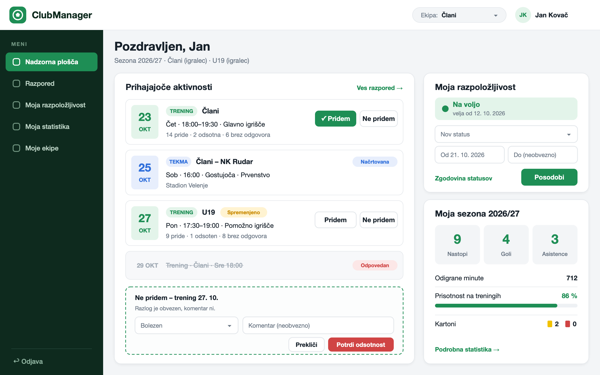
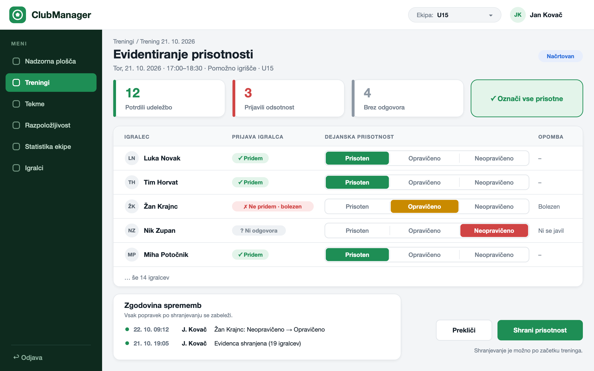
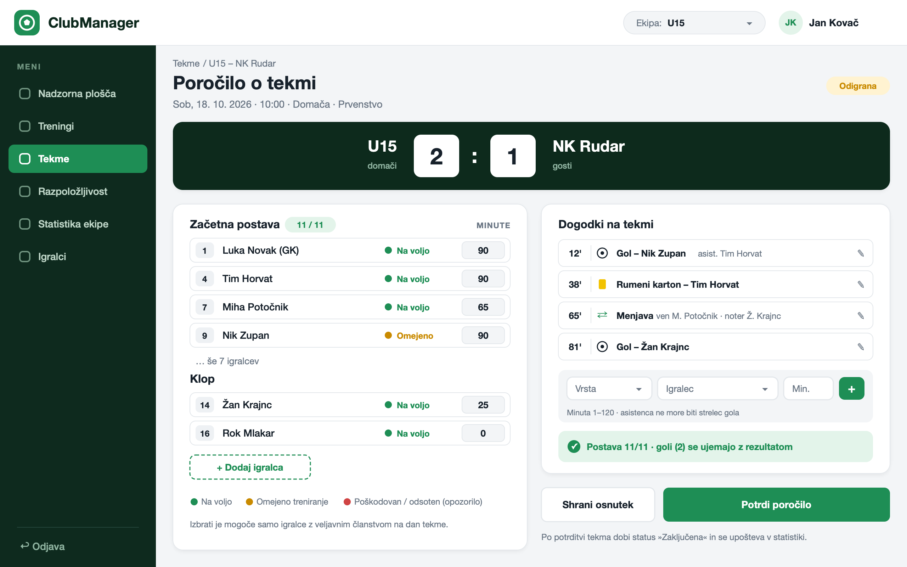
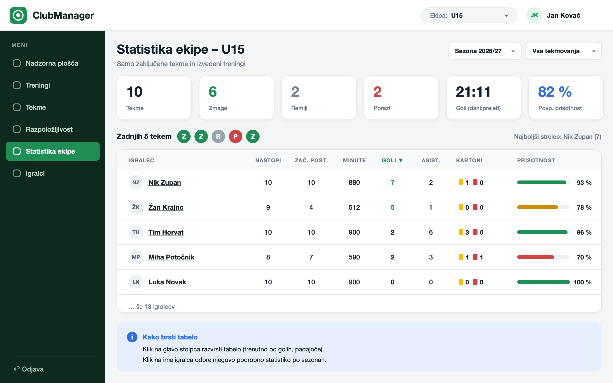

# 06 – Wireframes

## WF-01 – Nadzorna plošča igralca

Prvi zaslon, ki ga igralec vidi po prijavi. Prikazuje seznam prihajajočih treningov in tekem, kjer igralec z gumboma »Pridem« in »Ne pridem« potrdi udeležbo ali prijavi odsotnost z razlogom. Spremenjen trening ima oznako »Spremenjeno«, odpovedan trening je prečrtan. Na desni strani igralec posodobi svoj status razpoložljivosti in vidi povzetek svoje statistike v trenutni sezoni.

## WF-02 – Evidentiranje prisotnosti

Zaslon, na katerem trener po treningu vnese dejansko prisotnost. Na vrhu je povzetek prijav igralcev (potrdili, odsotni, brez odgovora) in gumb »Označi vse prisotne«. V tabeli je pri vsakem igralcu prikazana njegova prijava, trener pa izbere »Prisoten«, »Opravičeno odsoten« ali »Neopravičeno odsoten«. Spodaj je zgodovina kasnejših popravkov prisotnosti.

## WF-03 – Poročilo o tekmi

Zaslon, na katerem trener po tekmi vnese poročilo. Vsebuje rezultat, začetno postavo in klop z odigranimi minutami ter oznako razpoložljivosti igralcev. Na desni je kronološki seznam dogodkov (goli z asistencami, kartoni, menjave) in obrazec za nov dogodek. Polje »Preverjanje« sproti pokaže, ali je v postavi 11 igralcev in ali se goli ujemajo z rezultatom. Poročilo je mogoče shraniti kot osnutek ali ga potrditi.

## WF-04 – Statistika ekipe

Pregled statistike ekipe za trenerja. Na vrhu sta izbira sezone in tekmovanja ter povzetek ekipe (tekme, zmage, remiji, porazi, goli in povprečna prisotnost) in rezultati zadnjih petih tekem. Spodaj je tabela igralcev z nastopi, minutami, goli, asistencami, kartoni in prisotnostjo. Tabelo je mogoče razvrstiti po stolpcih, s klikom na igralca pa se odpre njegova podrobna statistika.
