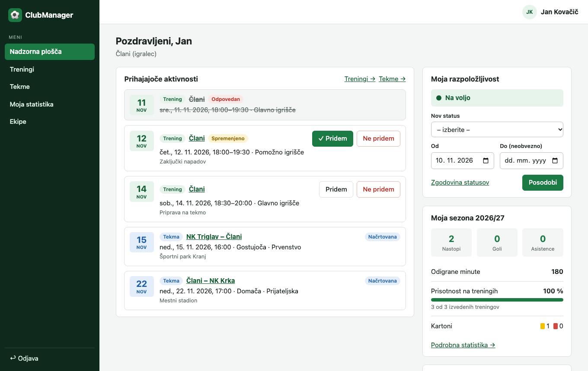
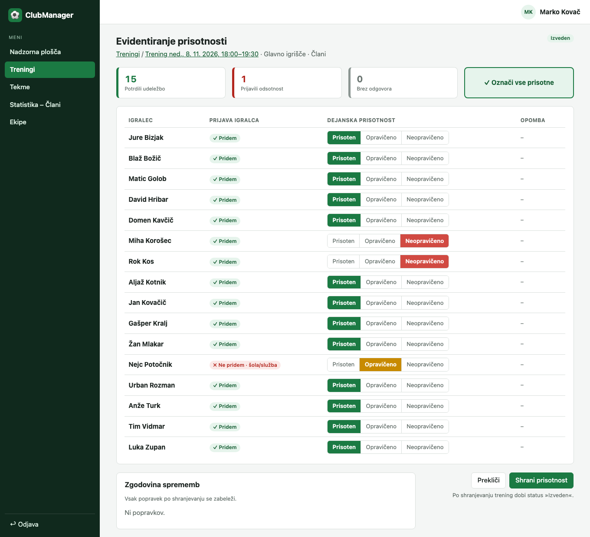
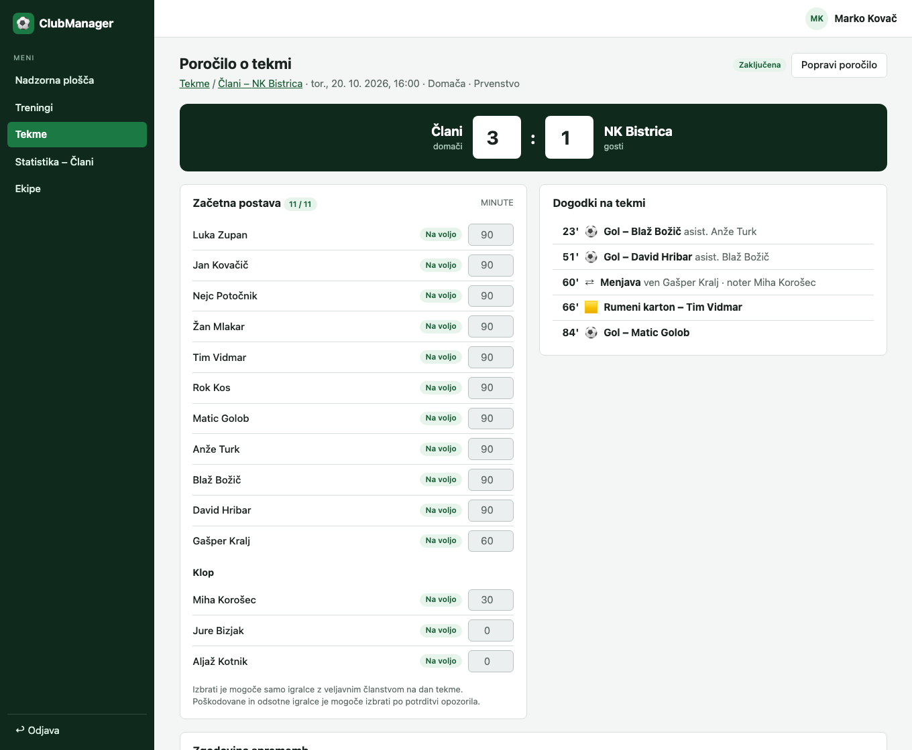
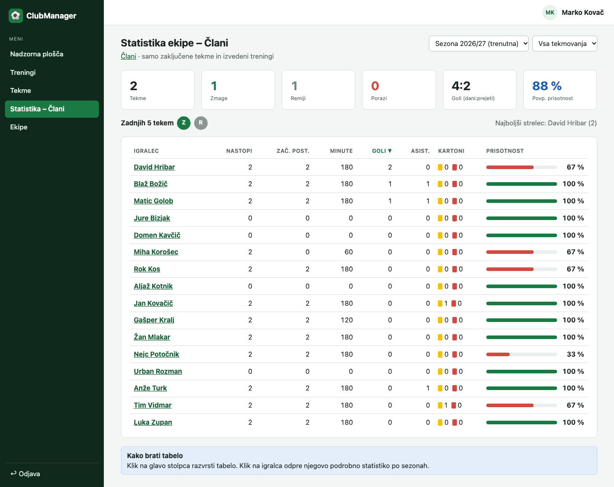

# 07 – Preverjanje MVP

Dokument opisuje, kako je bila implementacija MVP preverjena glede na pogoje sprejemljivosti (acceptance criteria, AC) iz dokumenta [05 – Uporabniške zgodbe](05-uporabniske-zgodbe.md).

## 1. Način preverjanja

| Oznaka | Način | Opis |
|---|---|---|
| **T** | Samodejni test API-ja | Vitest + Supertest na ločeni testni bazi. Vsaka testna datoteka pokriva eno uporabniško zgodbo, imena testov se začnejo z oznako pogoja (npr. »AC 2: …«). Zagon: `cd backend && npm test`. |
| **B** | Preizkus v brskalniku | Tok je bil izveden v brskalniku na testnih podatkih (`npm run db:seed`): izpolnitev obrazca, prikaz sporočila, prikaz na zaslonu. |
| **P** | Pregled izvedbe | Pogoj izhaja iz zasnove (npr. API nima brisanja, vrednost se izračuna ob branju) in je preverjen s pregledom kode in obnašanja. |

Stanje ob zaključku: **120 samodejnih testov, vsi uspešni**. Uporabniški vmesnik nima samodejnih testov – preverjen je bil ročno oziroma s skriptiranim preizkusom glavnih tokov v brskalniku za vse štiri vloge.

## 2. Rezultati po uporabniških zgodbah

Legenda izida: ✅ izpolnjeno · ⚠️ izpolnjeno z opombo (glej razdelek 3).

### F1 – Upravljanje ekip in članstev

| Zgodba | AC | Pogoj (povzetek) | Preverjanje | Izid |
|---|---|---|---|---|
| US-01 | 1 | Obvezna polja; datum konca po datumu začetka, napaka ob polju | T, P | ✅ |
| US-01 | 2 | Prekrivanje → »Obdobje se prekriva s sezono [naziv]« | T, B | ✅ |
| US-01 | 3 | Nova sezona »Načrtovana«; status se samodejno spremeni | T | ⚠️ |
| US-01 | 4 | Podatki zaključene sezone ostanejo in so na voljo v statistiki | T, P | ✅ |
| US-01 | 5 | Samo administrator, sicer 403 | T | ✅ |
| US-02 | 1 | Naziv 2–50 znakov, kategorija s seznama, napaka ob polju | T, B | ✅ |
| US-02 | 2 | Unikaten naziv med nearhiviranimi ekipami | T | ✅ |
| US-02 | 3 | Nova ekipa na seznamu, »Aktivna«, brez članov | T, B | ✅ |
| US-02 | 4 | Gumb »Nova ekipa« samo administratorju; sicer 403 | T, P | ✅ |
| US-03 | 1 | Uporabnik, ekipa, sezona, vsaj ena vloga, datum pridružitve | T, B | ✅ |
| US-03 | 2 | Podvojeno članstvo → »Uporabnik je že član te ekipe v izbrani sezoni« | T, B | ✅ |
| US-03 | 3 | Več ekip v isti sezoni z različnimi vlogami; vsa članstva na profilu | T, B | ✅ |
| US-03 | 4 | Datum odhoda članstva ne izbriše; prihodnjih aktivnosti ne vidi več | T | ✅ |
| US-03 | 5 | Nova ekipa vidna ob naslednjem nalaganju strani | T | ✅ |
| US-04 | 1 | Potrditveno okno »Ali res želite arhivirati ekipo [naziv]?« | B | ✅ |
| US-04 | 2 | Arhivirana ekipa ni na privzetem seznamu; filter »Arhivirane« | T, B | ✅ |
| US-04 | 3 | Za arhivirano ekipo ni novih treningov in tekem | T, B | ✅ |
| US-04 | 4 | Zgodovinski podatki ostanejo | T | ✅ |
| US-04 | 5 | »Ponovno aktiviraj« | T | ✅ |

### F2 – Načrtovanje treningov

| Zgodba | AC | Pogoj (povzetek) | Preverjanje | Izid |
|---|---|---|---|---|
| US-05 | 1 | Obvezni datum, ura začetka, ura konca, lokacija; vsebina do 500 znakov | T, B | ✅ |
| US-05 | 2 | Začetek ne v preteklosti; konec po začetku; napaka ob polju | T, B | ✅ |
| US-05 | 3 | »Načrtovan« trening v razporedu igralcev z veljavnim članstvom | T, B | ✅ |
| US-05 | 4 | Evidenca prisotnosti »Ni odgovora« za vsakega igralca | T | ✅ |
| US-05 | 5 | Samo ekipe, kjer je uporabnik trener | T, B | ✅ |
| US-06 | 1 | Sprememba, dokler je trening »Načrtovan« | T, B | ✅ |
| US-06 | 2 | Oznaka »Spremenjeno« do začetka treninga | T, B | ✅ |
| US-06 | 3 | »Odpovedan«: prečrtan v razporedu, brez potrjevanja udeležbe | T, B | ✅ |
| US-06 | 4 | Odpovedani treningi niso v odstotku prisotnosti | T | ✅ |
| US-06 | 5 | Izvedenega treninga ni mogoče odpovedati; gumba ni | T, P | ✅ |

### F3 – Evidentiranje prisotnosti

| Zgodba | AC | Pogoj (povzetek) | Preverjanje | Izid |
|---|---|---|---|---|
| US-07 | 1 | Gumba »Pridem« in »Ne pridem«, izbrani poudarjen | B | ✅ |
| US-07 | 2 | Obvezen razlog odsotnosti, komentar do 200 znakov | T, B | ✅ |
| US-07 | 3 | Sprememba do začetka treninga, nato gumba onemogočena | T, P | ✅ |
| US-07 | 4 | Trener vidi število potrjenih, odsotnih, brez odgovora | T, B | ✅ |
| US-07 | 5 | Samo svoja udeležba, sicer 403 | T | ✅ |
| US-08 | 1 | Igralci z veljavnim članstvom; predizpolnitev glede na prijavo | T, B | ✅ |
| US-08 | 2 | Tri možnosti; »Označi vse prisotne« | T, B | ✅ |
| US-08 | 3 | Shranjevanje po začetku treninga; status »Izveden« | T, B | ✅ |
| US-08 | 4 | Zgodovina sprememb (kdo, kdaj, stara in nova vrednost) | T, B | ✅ |

### F4 – Razpored tekem

| Zgodba | AC | Pogoj (povzetek) | Preverjanje | Izid |
|---|---|---|---|---|
| US-09 | 1 | Obvezna polja tekme | T, B | ✅ |
| US-09 | 2 | »Načrtovana« tekma v razporedu vseh članov | T, B | ✅ |
| US-09 | 3 | Urejanje in odpoved, dokler je »Načrtovana« | T | ✅ |
| US-09 | 4 | Vodja ekipe ne vidi polj za rezultat, postavo, dogodke | T, B | ✅ |
| US-09 | 5 | Samo ekipe, kjer je uporabnik vodja ekipe | T | ✅ |
| US-10 | 1 | Naziv 2–80 znakov in kraj | T | ✅ |
| US-10 | 2 | Podvojen klub → »Klub že obstaja v evidenci« | T, B | ✅ |
| US-10 | 3 | Iskanje od 2 znakov po delu naziva | T, B | ✅ |
| US-10 | 4 | Kluba s tekmo ni mogoče izbrisati, urejanje je mogoče | T, B | ✅ |

### F5 – Poročila o tekmah

| Zgodba | AC | Pogoj (povzetek) | Preverjanje | Izid |
|---|---|---|---|---|
| US-11 | 1 | Samo po terminu tekme in samo trener; status »Odigrana« | T, B | ✅ |
| US-11 | 2 | Samo igralci z veljavnim članstvom; opozorilo za poškodovane/odsotne | T, B | ✅ |
| US-11 | 3 | Natanko 11 igralcev v začetni postavi | T, B | ✅ |
| US-11 | 4 | Minute 0–120, celo število | T | ✅ |
| US-11 | 5 | Osnutek; »Potrdi poročilo« → »Zaključena« in v statistiki | T, B | ✅ |
| US-12 | 1 | Vrsta, igralec, minuta 1–120; kronološki prikaz | T, B | ⚠️ |
| US-12 | 2 | »Število golov se ne ujema z rezultatom« | T, B | ✅ |
| US-12 | 3 | Asistenca vezana na gol, ne isti igralec | T, B | ✅ |
| US-12 | 4 | Menjava: vstopi igralec s klopi | T, B | ✅ |
| US-12 | 5 | Brez dogodkov po rdečem kartonu | T | ✅ |
| US-13 | 1 | »Popravi poročilo« samo trenerju ekipe | T, B | ✅ |
| US-13 | 2 | Razlog popravka 10–200 znakov | T, B | ✅ |
| US-13 | 3 | Zgodovina: kdo, kdaj, razlog, stari in novi podatki | T, B | ✅ |
| US-13 | 4 | Statistika se ponovno izračuna | T | ✅ |
| US-13 | 5 | Zgodovino vidita trener in administrator, igralci ne | T | ✅ |

### F6 – Statistika igralcev in ekip

| Zgodba | AC | Pogoj (povzetek) | Preverjanje | Izid |
|---|---|---|---|---|
| US-14 | 1 | Nastopi, začetne postave, minute, goli, asistence, kartoni, prisotnost | T, B | ✅ |
| US-14 | 2 | Filter po sezoni (privzeto trenutna) in ekipi, tudi pretekle | T, B | ✅ |
| US-14 | 3 | Odstotek prisotnosti v času članstva, brez odpovedanih | T | ✅ |
| US-14 | 4 | Samo zaključene tekme | T | ✅ |
| US-14 | 5 | »Za izbrano sezono ni podatkov« | T, P | ✅ |
| US-15 | 1 | Povzetek ekipe: tekme, zmage, remiji, porazi, goli | T, B | ✅ |
| US-15 | 2 | Tabela igralcev, razvrščanje s klikom na glavo stolpca | T, B | ✅ |
| US-15 | 3 | Klik na igralca odpre podrobno statistiko po sezonah | T, B | ✅ |
| US-15 | 4 | Trener samo svoje ekipe, administrator vse | T | ✅ |

### F7 – Razpoložljivost igralcev

| Zgodba | AC | Pogoj (povzetek) | Preverjanje | Izid |
|---|---|---|---|---|
| US-16 | 1 | Štirje statusi, datum začetka (privzeto danes), neobvezen konec | T, B | ✅ |
| US-16 | 2 | Prejšnji status dobi datum konca; zgodovina na profilu | T, B | ✅ |
| US-16 | 3 | Po izteku datuma konca »Na voljo« | T | ⚠️ |
| US-16 | 4 | Trener vidi nov status ob naslednjem nalaganju | T, B | ✅ |
| US-17 | 1 | Barvne oznake statusov | B | ✅ |
| US-17 | 2 | Status za datum tekme, ne za danes | T | ✅ |
| US-17 | 3 | Povzetek po statusih | T, B | ✅ |

### Podporne funkcionalnosti – povabila in prijava

| Zgodba | AC | Pogoj (povzetek) | Preverjanje | Izid |
|---|---|---|---|---|
| US-18 | 1 | E-pošta, ekipa, sezona, vloga; pošlje se e-pošta s povezavo | T, B | ⚠️ |
| US-18 | 2 | Enkraten žeton, veljavnost 7 dni | T | ✅ |
| US-18 | 3 | Obstoječ račun → »Uporabnik že obstaja – dodajte ga v ekipo« | T | ✅ |
| US-18 | 4 | Seznam s statusi; ponovno pošiljanje poteklega povabila | T | ✅ |
| US-19 | 1 | Predizpolnjen, nespremenljiv e-poštni naslov | T, B | ✅ |
| US-19 | 2 | Pravila za geslo; ujemanje gesel | T, B | ✅ |
| US-19 | 3 | Po registraciji prijavljen, na nadzorni plošči, član ekipe | T, B | ✅ |
| US-19 | 4 | Uporabljena ali potekla povezava ni veljavna | T | ✅ |
| US-20 | 1 | Nadzorna plošča samo z ekipami uporabnika | T, B | ✅ |
| US-20 | 2 | Enotno sporočilo ob napačni prijavi | T, B | ✅ |
| US-20 | 3 | Zaklep po 5 neuspešnih poskusih v 15 minutah | T | ✅ |
| US-20 | 4 | Odjava uniči sejo; zaščitena stran preusmeri na prijavo | T, B | ✅ |

## 3. Opombe in odstopanja

**Samodejne spremembe statusov (US-01 AC 3, US-16 AC 3).** Status sezone in trenutni status razpoložljivosti se ne shranjujeta, ampak se izračunata ob vsakem branju iz datumov. Učinek za uporabnika je enak zahtevanemu (status se »spremeni« ob pravem datumu), ni pa ozadnjega opravila, ki bi vrednost prepisalo v bazi. Zato entiteta `Sezona` nima polja `status`, kot je bilo predvideno v dokumentu 03.

**Asistenca kot dogodek (US-12 AC 1).** V vmesniku se asistenca vnese skupaj z golom (izbira asistenta), ne kot ločena vrsta dogodka v izbirnem seznamu. V bazi je shranjena kot samostojen dogodek vrste `ASISTENCA`, vezan na svoj gol, kar neposredno zagotavlja AC 3.

**E-pošta (US-18 AC 1).** Povabila se pošiljajo prek SMTP. V lokalnem okolju jih prestreže Mailpit (<http://localhost:8025>), zato se nič ne pošlje na prave naslove. Za dejansko dostavo je treba v `backend/.env` nastaviti pravi strežnik SMTP.

**Dopolnitve podatkovnega modela.** Ob implementaciji so bila dodana polja, ki jih uporabniške zgodbe zahtevajo, dokument 03 pa jih ni navedel: zaklep prijave pri `Uporabnik` (US-20), `zacetek`/`konec`/`vsebina`/`spremenjenOb` pri `Trening` (US-05, US-06), razlog in komentar pri `Prisotnost` (US-07), `jeDomaca`/`lokacija`/`vrstaTekmovanja` pri `Tekma` (US-09), povezava asistenca → gol in igralec, ki vstopi, pri `DogodekNaTekmi` (US-12), razlog pri `ZgodovinaTekme` (US-13), ekipa in sezona pri `Povabilo` (US-18).

**Dodatna pravila, ki jih zgodbe ne navajajo izrecno.**
- Tekmo je mogoče ustvariti samo za termin v prihodnosti (enako kot trening).
- Za isti e-poštni naslov ne moreta hkrati obstajati dve veljavni povabili.
- Pri menjavi mora biti igralec, ki zapusti igrišče, takrat na igrišču; isti igralec ne more vstopiti dvakrat.
- Nastop v statistiki pomeni vsaj eno odigrano minuto; igralec, ki je ostal na klopi, nima nastopa.
- Evidenco nasprotnih klubov ureja vodja katere koli ekipe kluba; administrator športnih evidenc ne ureja (v skladu z opisom vlog v dokumentu 02).

## 4. Izven obsega te naloge

- Samodejni testi uporabniškega vmesnika (komponentni ali end-to-end) niso del repozitorija.
- Namestitev v produkcijsko okolje (HTTPS, produkcijska shramba sej, pravi strežnik SMTP) ni izvedena; projekt je pripravljen za lokalni zagon po navodilih v [README](../README.md).
- Funkcionalnosti 8–14 iz dokumenta 02 (prevozi, obveščanje, prenos članstev med sezonami, poškodbe, rehabilitacija, napredna primerjava, obvestila) niso del MVP.

## 5. Zasloni

Implementirani zasloni, ki ustrezajo wireframom iz dokumenta [06](06-wireframes.md):

| Wireframe | Implementacija |
|---|---|
| WF-01 – Nadzorna plošča igralca |  |
| WF-02 – Evidentiranje prisotnosti |  |
| WF-03 – Poročilo o tekmi |  |
| WF-04 – Statistika ekipe |  |
